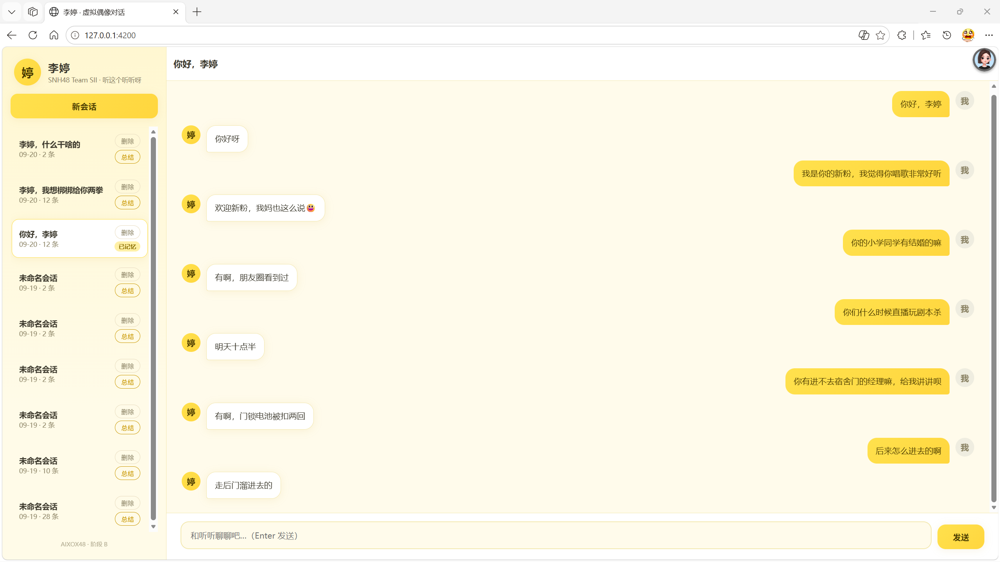

# virtual-idol · 虚拟偶像对话引擎（李婷）

> AIXOX48 项目第二阶段：从口袋48 抓取的历史消息中学习 SNH48 Team SII 成员**李婷**的语气、性格与真实经历，生成一个"虚拟版李婷"对话服务。
>
> **阶段 A（人格引擎）与阶段 B（对话网页）均已完成并验收**。浏览器打开 `http://127.0.0.1:4200/` 即可和她聊天；终端可用 `node cli/chat.mjs` 试聊；全部能力通过 HTTP API 暴露，可二次开发。

---

## 一、项目介绍



### 1.1 这是什么

把李婷在口袋48房间里说过的 **38,468 条**历史消息，转化成一个能**以她的口吻**和粉丝聊天的 AI 服务。

- 重点不是"问答正确"，而是 **"像不像她"**——短句、口语化、亲切但带点直接、叫粉丝"宝宝"、会接梗、会引用她真实经历过的事。
- 本质是 **RAG（检索增强生成）**：用户每次提问，先从她 3.2 万条真实历史消息里检索相关内容，注入到系统提示词中，再交给大模型生成回复。

### 1.2 项目背景（AIXOX48 全景）

```
pocket48-scraper（上游，端口 4100）
   └─ 抓取口袋48 房间消息（李婷本人 38,468 条）→ pocket48.db
        │
        ▼
virtual-idol（本仓库，端口 4200）
   ├─ 阶段 A：离线管线构建人格画像 + 向量库 → 命令行人格引擎（已验收）
   └─ 阶段 B：对话网页（SSE 流式 / 会话管理 / 跨会话记忆 / 移动端适配）（已验收）
```

### 1.3 能力边界

| ✅ 能做好 | ⚠️ 已知短板 |
|---|---|
| 短句、口语化回复（历史平均 9 字，中位数 8 字） | 纯表情/单字回复（"👍🏻""gun"）——LLM 天性，不是 bug |
| 亲切、会叫粉丝"宝宝"、主动接话 | 实时性事实（今天日程、当天吃了啥）——历史数据只覆盖近一年 |
| 引用她真实经历（"刷朋友圈看到小学同学结婚"） | 涉及她真实生活但历史未覆盖的事，可能说"不知道" |
| 接梗、适度怼粉、不圆场 | 上下文超过 20 条后较早的对话会被裁剪（历史截断） |

### 1.4 数据来源

- 上游：`pocket48-scraper`（端口 4100，SQLite），已抓取李婷本人消息 **38,468 条**（其中本人文字消息 32,043 条入库）
- 李婷身份：`serverId = 29266435`，`serverOwner/userId = 161808465`，房间名「听这个听听呀」
- 粉丝称呼：听听 / 婷 / 婷婷 / 姐 / 老婷
- 关键人设关键词：宠物猫"噜噜"（曾说要改名"玄武"）、常点外卖（米村拌饭/刘文祥麻辣烫）、声动星河潜力新人、被粉丝调侃"媚粉"、修图不要太假、旧手机放转转回收

---

## 二、快速开始（5 分钟上手）

### 2.1 环境要求

- **Node.js 22+**（用到实验特性 `node:sqlite`，启动时有 ExperimentalWarning，**属正常，别去消除**）
- **火山方舟账号**：已开通对话模型 `doubao-seed-2-1-pro-260915` + Embedding 模型 `doubao-embedding-vision-251215`
- （仅首次构建数据时需要）上游 `pocket48-scraper/data/pocket48.db` 存在

### 2.2 配置密钥

```powershell
cd E:\project\AIXOX48\virtual-idol
# 首次：把 config.local.json 里的 apiKey 填成你的方舟 API key
```

密钥加载优先级：**环境变量 > config.local.json > 内置默认值**。缺失 apiKey 时服务会打印 `[config] 缺少 ARK_API_KEY` 但仍启动（对话会失败）。

### 2.3 启动服务

```powershell
cd E:\project\AIXOX48\virtual-idol
node src/index.js
```

启动输出：

```
[virtual-idol] 服务已启动: http://127.0.0.1:4200
[virtual-idol] 偶像: 李婷 (SNH48 Team SII)
[virtual-idol] 对话模型: doubao-seed-2-1-pro-260915 | 向量模型: doubao-embedding-vision-251215
[virtual-idol] 健康检查: http://127.0.0.1:4200/health
```

> 服务监听所有网卡（`0.0.0.0`），**同一局域网内的手机/其他设备可直接用 `http://<电脑IP>:4200/` 访问**（如 `http://192.168.1.101:4200/`）。

### 2.4 三种使用方式

| 方式 | 入口 | 适用 |
|---|---|---|
| **网页** | 浏览器打开 `http://127.0.0.1:4200/` | 日常聊天、体验流式打字与跨会话记忆 |
| **CLI 终端** | `node cli/chat.mjs` | 调试、快速验证人格语气 |
| **HTTP API** | `http://127.0.0.1:4200/api/v1/*` | 二次开发、接入其他系统 |

---

## 三、技术栈

| 层 | 选型 | 说明 |
|---|---|---|
| 对话模型 | 火山方舟 `doubao-seed-2-1-pro-260915` | SSE 流式生成，temperature 0.85 |
| Embedding 模型 | 火山方舟 `doubao-embedding-vision-251215` | 多模态端点 `/embeddings/multimodal`，dim=2048，一次只向量化一条 |
| 运行时 | Node.js 22+ | 原生 `node:sqlite`（实验特性，有 warning 可用） |
| HTTP | 原生 `node:http`（**零 npm 依赖**） | SSE 流式响应 + 静态页面托管 |
| 存储 | SQLite（WAL 模式）+ 内存 `Float32Array` 向量库 | 对话/记忆入库；向量启动时整体加载进内存（约 184MB） |
| 前端 | 原生 HTML + CSS + JavaScript（零框架零构建） | 由 4200 服务直接托管 |

> **⚠️ Embedding 关键坑**：`doubao-embedding-vision-251215` **不是** OpenAI 兼容的 `/embeddings` 端点，必须走 `/embeddings/multimodal`，input 格式为 `[{type:"text", text:"..."}]` 数组，**一次请求只向量化一条文本**。本仓库的 `chat.js` 已封装并发池（默认并发 8）。

---

## 四、系统架构

### 4.1 分层结构

```
┌────────────────────────────────────────────────────────────┐
│  展示层：public/（网页） + cli/（终端）                     │
└──────────────────────────┬─────────────────────────────────┘
                           │ HTTP / SSE
┌──────────────────────────▼─────────────────────────────────┐
│  API 层：src/api/routes.js                                 │
│    /health /persona /conversations /chat /静态页面          │
└──────────────────────────┬─────────────────────────────────┘
┌──────────────────────────▼─────────────────────────────────┐
│  核心层 src/core/                                          │
│    chat.js      ← 方舟 SSE 对话 + embedding 并发池          │
│    prompt.js    ← system prompt 组装（人格+记忆+示例+规则）  │
│    retriever.js ← 消息加载 + 向量余弦检索 + 关键词兜底        │
│    memory.js    ← 会话摘要生成 + 跨会话记忆读取              │
└──────────────────────────┬─────────────────────────────────┘
┌──────────────────────────▼─────────────────────────────────┐
│  数据层                                                    │
│    db/database.js ← SQLite 三表（会话/消息/记忆）            │
│    data/          ← persona.json / 向量库 / 消息 / 统计      │
└────────────────────────────────────────────────────────────┘
```

### 4.2 一次对话的完整流程（`POST /api/v1/chat`）

```
粉丝消息
   │
   ▼
 1. 取/建会话 ── 不传 conversationId 则新建（SQLite conversations 表）
   │
 2. 向量化用户问题 ── embedText() 走 multimodal 端点（懒加载向量库）
   │
 3. 检索 ── retriever.search()：
   │      ├─ 向量语义检索 top-8（余弦相似度，向量已预归一化）
   │      └─ 命中 <2 条时关键词 LIKE 兜底（提取 2~6 字中文词）
   │
 4. 按类型分流（RAG 双路，见 4.3）
   │      ├─ TEXT（她主动发的）→ selfMemories：「你以前说过的话」
   │      └─ REPLY（她回粉丝的）→ examples：「你平时怎么回复粉丝」
   │
 5. 跨会话记忆 ── 仅新会话注入最近 5 条历史摘要（recentMemories）
   │
 6. 组装 messages ── buildSystemPrompt() + 会话内最近 20 条历史 + 用户消息
   │
 7. 流式调用模型 ── chatStream()，temperature 0.85，maxTokens 600
   │
 8. SSE 推送 ── meta → delta（逐字）→ 存消息 → done
```

### 4.3 核心设计：RAG 双路分流

这是阶段 A 最后一轮的关键修复。早期把检索到的消息**全部**当风格示例注入，模型不知道哪条是"她自己的经历"，导致问"小学同学结婚"她答"不知道"。

现在按消息类型分流：

- **TEXT 类型**（她主动发的动态）→ 注入为「你以前在房间里说过的话（这是你自己的经历和记忆，回答相关问题时自然引用，不要假装不知道）」
- **REPLY 类型**（她回粉丝的）→ 注入为「你平时怎么回复粉丝（模仿这个语气，这是你本人的原话）」

效果：问事实时她"记得"，问风格时她"像她"。**网页阶段不要动这个逻辑**。

### 4.4 检索器双通道（retriever.js）

| 通道 | 机制 | 触发条件 |
|---|---|---|
| 向量语义检索（主力） | 2048 维 Float32Array 全量内存余弦（预归一化，点积即相似度） | 向量库已加载且结果 ≥2 条 |
| 关键词 LIKE（兜底） | 抽取查询中的 2~6 字中文词，命中数优先、时间近次之；`GIFTREPLY` 类型（模板致谢）不参与 | 向量未就绪或向量结果 <2 条 |

向量库**懒加载**：服务启动时不读 184MB 向量文件，第一次对话时才 `loadVectors()`。因此刚启动时 `/health` 的 `vectorReady` 为 `false` 属正常。

### 4.5 跨会话记忆机制（memory.js）

```
会话聊完 ── 调 /api/v1/conversations/:id/summarize（或 CLI /summary）
   │ 模型把整段会话（最多 40 条）压缩成 ≤100 字第三人称摘要
   │ （temperature 0.3，maxTokens 200，只保留身份线索/话题/承诺）
   ▼
存 conversation_memory 表（upsert）
   │
   ▼
下次新建会话 ── 自动注入最近 5 条历史摘要到 system prompt
   │
   ▼
模型回答时可自然提及（"上次你说…"），但不机械复述
```

> 网页端通过每个会话的"总结"按钮手动触发；CLI 用 `/summary`。

### 4.6 多成员扩展预留

当前单成员（李婷），架构已预留多成员：

| 位置 | 预留 |
|---|---|
| `config.idol.serverId` | 成员房间 ID 配置 |
| `conversations.member_server_id` 列 | 会话按成员隔离 |
| `src/db/database.js` 的 `listConversations(memberServerId)` | 按成员查会话 |
| 前端 `app.js` 的 `MEMBERS` 注册表 | 加一行 `{serverId, name, team}` 即可注册新成员 |
| `index.html` 的 `.member-select` | 成员切换器（当前 `hidden`） |
| `persona.json` | 目前单人，未来可扩展为 `personas/<serverId>.json` |

---

## 五、目录结构（完整）

```
virtual-idol/
├── README.md                    ← 本文档
├── config.local.json            ← 本地敏感配置（API key，已 gitignore）
├── .gitignore
│
├── public/                      ← 阶段 B 对话网页（由 4200 静态托管）
│   ├── index.html               ← 页面骨架（含隐藏的多成员选择器）
│   ├── style.css                ← 柠檬黄应援色浅色偶像风（含移动端媒体查询）
│   └── app.js                   ← SSE 流式渲染/会话管理/总结/删除/移动端抽屉
│
├── src/                         ← 服务端
│   ├── index.js                 ← 服务入口：http 服务器，端口 4200，启动预热消息
│   ├── config.js                ← 配置加载（config.local.json + 环境变量覆盖）
│   ├── api/
│   │   └── routes.js            ← 全部 HTTP 路由 + 静态文件托管 + SSE 协议
│   ├── core/
│   │   ├── chat.js              ← 方舟 chat/completions SSE 客户端 + embedding 并发池
│   │   ├── prompt.js            ← system prompt 组装（人格+记忆+示例+聊天规则）
│   │   ├── retriever.js         ← 消息加载 + 向量余弦检索 + 关键词 LIKE 兜底
│   │   └── memory.js            ← 会话摘要生成 + 跨会话记忆读取
│   └── db/
│       └── database.js          ← SQLite 三表 + 会话/消息/记忆增删查
│
├── cli/
│   └── chat.mjs                 ← 终端试聊（/new /history /summary /persona /help /exit）
│
├── scripts/                     ← 离线管线（一次性跑过，可重跑，见第十二节）
│   ├── extract-messages.mjs     ← ① 从 scraper SQLite 抽消息 → liting_texts.jsonl
│   ├── analyze-stats.mjs        ← ② 纯确定性语言特征统计 → liting_stats.json
│   ├── prepare-samples.mjs      ← ③ 抽样人格样本 + 留出评测集
│   ├── build-persona.mjs        ← ④ LLM 提炼人格画像 → persona.json
│   ├── build-vectors.mjs        ← ⑤ 批量向量化 → embeddings.bin + meta
│   ├── pick-examples.mjs        ← 辅助：精选代表性对话对 → persona.json.examples
│   ├── evaluate.mjs             ← ⑥ 自动评测（生成+裁判打分）→ eval_report.json
│   └── test-retrieval.mjs       ← 辅助：手动验证向量检索命中
│
└── data/                        ← 数据与产物（运行时 + 离线构建）
    ├── liting_texts.jsonl        ← 32,043 条本人文字消息（4.4MB）
    ├── liting_stats.json         ← 语言特征统计（2.2MB，27 个统计键）
    ├── persona.json              ← 人格画像（人工可改，改完重启）
    ├── persona_samples.jsonl     ← 人格提炼输入样本（31KB）
    ├── eval_pairs.jsonl          ← 120 条留出评测对（12KB）
    ├── eval_report.json          ← 历次评测分数（9KB）
    ├── embeddings.bin            ← 23,527 条 2048 维向量（188MB）
    ├── embeddings.meta.jsonl     ← 每条向量对应的消息元数据（875KB）
    └── virtual_idol.db           ← 对话 SQLite（WAL；另有 -shm/-wal 伴随文件）
```

---

## 六、数据与产物详解

### 6.1 数据文件总表

| 文件 | 内容 | 大小 | 是否可改 |
|---|---|---|---|
| `persona.json` | 人格画像（见 6.2） | 7KB | ✅ **主要调优点**，改完重启生效 |
| `liting_texts.jsonl` | 每行一条：`{msgId, msgTime, type, text, fanText, fanName}` | 4.4MB | 由 extract 脚本生成，一般不动 |
| `liting_stats.json` | 语言特征统计（见 6.3） | 2.2MB | 由 analyze-stats 生成，可查不可改 |
| `persona_samples.jsonl` | 人格提炼输入（抽样 TEXT + REPLY 对话对） | 31KB | 由 prepare-samples 生成 |
| `eval_pairs.jsonl` | 120 条「粉丝原话→李婷真实回复」留出集 | 12KB | **评测基准，勿动** |
| `eval_report.json` | 历次评测分数 | 9KB | 由 evaluate 自动写 |
| `embeddings.bin` + `embeddings.meta.jsonl` | 向量库（Float32 扁平数组 + 元数据） | 188MB + 875KB | 改了文本数据需重跑 `build-vectors.mjs`（约 7 分钟） |
| `virtual_idol.db` | 运行时数据（会话/消息/记忆） | 几 KB~数 MB | 运行时自动写 |

### 6.2 人格画像 `persona.json` 字段详解

| 字段 | 内容 | 作用 |
|---|---|---|
| `identity` | 成员身份、房间名、粉丝称呼 | 告诉模型"你是谁" |
| `personality` | 性格总述（随性松弛、冷幽默、无偶像包袱、情绪平缓） | 整体基调 |
| `speechStyle` | 10 条说话风格（短句、句尾少标点、文言反差、"非也""何意味"等） | 语气约束 |
| `catchphrases` | 15 个口头禅/习惯词（噜噜、翻牌、不知道、下班…） | 高频词汇倾向 |
| `emojiHabits` | 表情习惯（小黄脸为主，单条 ≤3 个） | 表情使用约束 |
| `lifeFacts` | 26 条真实生活经历（养猫噜噜、点外卖、公演排练…） | 事实记忆来源 |
| `topics` | 10 个常聊主题分类 | 话题引导 |
| `examples` | 14 条精选「粉丝原话→真实回复」对话对 | 风格 few-shot |
| `version` | 构建日期 | 版本记录 |

### 6.3 语言特征统计 `liting_stats.json`（27 个键）

| 类别 | 键 | 说明 |
|---|---|---|
| 总量 | `total` / `totalChars` | 32,043 条 / 288,864 字 |
| 类型 | `byType` | TEXT / GIFTREPLY / REPLY 分布 |
| 长度 | `lenAvg` / `lenMedian` / `lenMax` / `lenBuckets` / `topLen50` | 平均 9 字、中位 8 字、最长 300 字 |
| 用词 | `wordFreq` / `topWords` | 高频词（哈喽、我来啦…） |
| 语气词 | `particleFreq` / `topParticles` | 哈、呀、啦、么、呢… |
| 表情 | `emojiFreq` / `topEmoji` | 高频 emoji（🍊😉😘…） |
| 标点 | `exclaimPct` / `questionPct` / `ellipsisPct` / `tildePct` | 感叹/疑问/省略/波浪号占比 |
| 起止 | `startsWith` / `endsWith` / `topStarts` / `topEnds` | 消息开头/结尾习惯 |
| 时段 | `hourFreq` / `hourTop` | 活跃时段（22时、0时、17时…） |
| 其他 | `selfRef` / `topSelfRef` / `replyLenRatio` | 自称习惯、回复长度比 |

> **小坑**：该文件含大小写重复键（如 `iphone`/`iPhone`），PowerShell 的 `ConvertFrom-Json` 会报"重复键"错误，Node 的 `JSON.parse` 不受影响（后者键覆盖）。查看请用 Node 或 VS Code。

### 6.4 SQLite 三表结构（`virtual_idol.db`）

```sql
conversations (
  id TEXT PRIMARY KEY,              -- UUID
  member_server_id INTEGER NOT NULL, -- 成员房间（多成员预留）
  title TEXT DEFAULT '新会话',       -- 首条用户消息自动生成（前 20 字）
  created_at INTEGER NOT NULL,      -- 毫秒时间戳
  updated_at INTEGER NOT NULL
);

chat_messages (
  id INTEGER PRIMARY KEY AUTOINCREMENT,
  conversation_id TEXT NOT NULL,    -- 外键→conversations.id
  role TEXT NOT NULL,               -- user / assistant
  content TEXT NOT NULL,
  created_at INTEGER NOT NULL
);
-- 索引：idx_chat_conv(conversation_id, id)

conversation_memory (
  conversation_id TEXT PRIMARY KEY, -- 一个会话最多一条摘要（upsert）
  summary TEXT NOT NULL,            -- ≤100 字第三人称摘要
  token_count INTEGER DEFAULT 0,
  created_at / updated_at INTEGER
);
```

WAL 模式：读写在 `-wal` 文件缓冲，读写并发友好。`virtual_idol.db-wal`（当前约 2.2MB）是正常伴随文件。

---

## 七、配置

### 7.1 `config.local.json`（本地，已 gitignore）

```json
{
  "ark": {
    "apiKey": "ark-xxxxxxxx",
    "baseUrl": "https://ark.cn-beijing.volces.com/api/v3",
    "chatModel": "doubao-seed-2-1-pro-260915",
    "embeddingModel": "doubao-embedding-vision-251215"
  },
  "server": { "port": 4200 },
  "idol": {
    "serverId": 29266435,
    "serverOwner": 161808465,
    "name": "李婷",
    "team": "SNH48 Team SII"
  }
}
```

### 7.2 环境变量覆盖（优先级高于文件）

| 变量 | 作用 |
|---|---|
| `ARK_API_KEY` | 方舟 API key |
| `ARK_BASE_URL` | 方舟 API 地址（默认官方） |
| `ARK_CHAT_MODEL` | 对话模型 |
| `ARK_EMBEDDING_MODEL` | Embedding 模型 |
| `PORT` | 服务端口（默认 4200） |
| `IDOL_BASE` | 仅 CLI 用：服务地址（默认 `http://127.0.0.1:4200`） |

### 7.3 安全提醒

> ⚠️ API key 曾在对话中出现，**建议在方舟控制台轮换**。key 只存在于 `config.local.json`（已 gitignore），不要提交到仓库、不要写入日志。

---

## 八、HTTP API 完整参考

Base URL：`http://127.0.0.1:4200`

| 方法 | 路径 | 用途 |
|---|---|---|
| GET | `/` | 对话网页（静态托管） |
| GET | `/style.css` `/app.js` | 网页静态资源 |
| GET | `/health` | 健康检查 |
| GET | `/api/v1/persona` | 查看人格画像 |
| GET | `/api/v1/conversations` | 会话列表（最近 50 个） |
| GET | `/api/v1/conversations/:id` | 会话详情 + 消息历史（最多 100 条） |
| DELETE | `/api/v1/conversations/:id` | 删除会话（连带消息与记忆摘要） |
| POST | `/api/v1/conversations/:id/summarize` | 生成该会话的跨会话记忆摘要 |
| POST | `/api/v1/chat` | 对话（SSE 流式） |

### 8.1 `GET /health` — 健康检查

```json
{
  "ok": true,
  "service": "virtual-idol",
  "time": "2026-09-19T15:23:54.735Z",
  "idol": "李婷",
  "persona": true,
  "historyMessages": 32043,
  "vectorReady": true,
  "vectorDim": 2048,
  "chatModel": "doubao-seed-2-1-pro-260915",
  "embeddingModel": "doubao-embedding-vision-251215"
}
```

> `vectorReady` 首次对话时才懒加载向量库，刚启动为 `false` 属正常。

### 8.2 `POST /api/v1/chat` — 对话（SSE 流式）

**请求体**：

```json
{ "message": "你好呀", "conversationId": "可选，不传则新建" }
```

参数说明：
- `message`：必填，用户消息，最长 500 字（超出截断）
- `conversationId`：可选；不传或传不存在的 id 会新建会话（404 只在传了 id 但找不到时返回）

**响应**：`text/event-stream; charset=utf-8`，事件序列见第九节。

**curl 示例（Linux/macOS）**：

```bash
curl -N http://127.0.0.1:4200/api/v1/chat \
  -H "Content-Type: application/json" \
  -d '{"message":"你好李婷我是新粉丝"}'
```

### 8.3 `GET /api/v1/persona` — 人格画像

返回完整 `persona.json`（含 identity/personality/speechStyle/catchphrases/emojiHabits/lifeFacts/topics/examples/version）。

### 8.4 `GET /api/v1/conversations` — 会话列表

返回当前成员最近 50 个会话，按 `updated_at` 倒序。每条：

```json
{
  "id": "682c33b1-...",
  "member_server_id": 29266435,
  "title": "你好，李婷",
  "created_at": 1789829506511,
  "updated_at": 1789829828094,
  "msg_count": 12,
  "has_memory": 1
}
```

- `title`：首条用户消息自动生成（前 20 字）；旧数据可能为"新会话"
- `msg_count`：消息条数（含 user 与 assistant）
- `has_memory`：1 = 已生成跨会话记忆摘要，0 = 未总结

### 8.5 `GET /api/v1/conversations/:id` — 会话详情

```json
{
  "conversation": { "id": "...", "title": "...", ... },
  "messages": [ { "role": "user", "content": "你好", "created_at": 1789829506511 }, ... ]
}
```

消息按时间正序，最多 100 条。会话不存在返回 `404 {"error":"会话不存在"}`。

### 8.6 `DELETE /api/v1/conversations/:id` — 删除会话

级联删除：该会话的 `chat_messages` + `conversation_memory` + `conversations` 记录。返回 `{"ok":true}`。删除后新会话不再注入它的记忆。

### 8.7 `POST /api/v1/conversations/:id/summarize` — 生成跨会话记忆

把该会话最近 40 条消息压缩成 ≤100 字第三人称摘要，写入 `conversation_memory`（upsert）。返回：

```json
{ "summary": "这位粉丝是新粉，夸她唱歌好听…" }
```

会话为空时返回空摘要；LLM 调用失败返回 `502`。**新会话开始时自动注入最近 5 条摘要**（见 4.5）。

---

## 九、SSE 流式协议（前端对接规范）

`POST /api/v1/chat` 返回 `text/event-stream`，每条事件格式：

```
event: <事件名>
data: <JSON>

```

**事件序列**：

| 事件 | data | 说明 |
|---|---|---|
| `meta` | `{conversationId, isNew, examplesCount, selfMemCount, vectorUsed}` | 对话开始；`isNew` 为 true 表示新建会话；`selfMemCount`=检索到的她的往事条数，`examplesCount`=风格示例条数 |
| `delta` | `{text}` | 模型增量输出，逐字/逐词推送，前端直接追加 |
| `done` | `{full, chars}` | 流结束；`full` 为完整回复，`chars` 为字数；出错时带 `error` 字段 |
| `error` | `{message}` | 出错中断 |

**前端对接要点**：

1. 必须用 `fetch + ReadableStream`（POST 请求），**不要用 `EventSource`**（EventSource 只支持 GET）
2. 用 `TextDecoder('utf-8', {stream:true})` 解码，避免中文跨 chunk 截断成乱码
3. 按 `\n\n` 切分事件块，缓冲未完整块
4. `delta` 事件按 `{text}` 累加渲染即"打字机效果"
5. 浏览器请求发完 body 后**不要关闭写端**（某些 HTTP 客户端如 PowerShell `Invoke-WebRequest` 会触发后端 abort，导致回复被截断成短句——见 15.4）

---

## 十、前端网页（阶段 B）

### 10.1 功能清单

- ✅ SSE 流式打字效果（逐字渲染 + 光标动画）
- ✅ 左侧会话列表（标题/相对时间/消息数/记忆状态）
- ✅ 会话切换、历史回显
- ✅ 首条用户消息自动生成会话标题
- ✅ "总结"按钮 → 生成跨会话记忆（成功后显示"已记忆"徽标）
- ✅ "删除"按钮 → 确认后删除会话（连带消息与记忆）
- ✅ meta 提示条（"她记得 X 条往事 · 参考 Y 条风格示例"）
- ✅ "李婷正在输入…"三点动画
- ✅ 移动端适配（≤720px：抽屉式会话列表 + 遮罩 + 汉堡按钮）
- ✅ 多成员预留（隐藏成员选择器 + `MEMBERS` 注册表）
- ✅ Enter 发送 / Shift+Enter 换行；输入中防重复发送

### 10.2 前端文件职责

| 文件 | 职责 |
|---|---|
| `index.html` | 骨架：侧边栏（品牌/新会话/会话列表）+ 聊天区（header/消息/输入） |
| `style.css` | 柠檬黄（`#FFE14D`）应援色体系；CSS 变量集中配色；`@media (max-width:720px)` 抽屉布局 |
| `app.js` | 状态机（currentConvId/sending）+ SSE 解析 + 渲染 + API 封装 + 抽屉交互 |

### 10.3 移动端适配说明

- 断点：`max-width: 720px`
- 移动端侧边栏改为 `position: fixed` 抽屉（`width: min(80vw, 300px)`），默认 `translateX(-100%)` 隐藏
- 聊天区全屏；左上角"☰"汉堡按钮滑出抽屉；点击遮罩或选择会话自动收起
- 点汉堡按钮 → `body.sidebar-open`；遮罩监听排除汉堡按钮本身（否则闪开闪关）
- 回到桌面宽度自动清除抽屉状态（resize 监听）
- iOS 输入框 `font-size:16px` 防聚焦缩放

---

## 十一、CLI 终端工具

```powershell
cd E:\project\AIXOX48\virtual-idol
node cli\chat.mjs [会话ID]
```

可选参数：传入会话 ID 可续聊指定会话。

| 命令 | 作用 |
|---|---|
| 直接输入 | 发消息聊天（SSE 流式显示） |
| `/new` | 开新会话 |
| `/history` | 查看当前会话历史 |
| `/summary` | 当前会话生成记忆摘要 |
| `/persona` | 查看当前人格画像（前 2500 字） |
| `/help` | 帮助 |
| `/exit` / `/quit` | 退出 |

---

## 十二、离线管线脚本（一般不用重跑）

按顺序执行（首次跑过一次即可；数据变更后可重跑）：

```powershell
cd E:\project\AIXOX48\virtual-idol\scripts

node extract-messages.mjs     # ① 从 scraper SQLite 抽消息 → liting_texts.jsonl
node analyze-stats.mjs        # ② 纯确定性语言特征统计 → liting_stats.json（不调模型）
node prepare-samples.mjs      # ③ 抽样人格样本 + 留出评测集
node build-persona.mjs        # ④ LLM 提炼人格 → persona.json（输入 ③ 的样本 + ② 的统计）
node build-vectors.mjs        # ⑤ 批量向量化 → embeddings.bin + meta（约 7 分钟，并发 8）
node evaluate.mjs 30          # ⑥ 跑 N 条评测打分（可选）
```

辅助脚本：

- `pick-examples.mjs`：从历史精选代表性对话对，写入 `persona.json` 的 `examples`
- `test-retrieval.mjs`：手动验证向量检索命中（如问"小学同学有结婚的嘛"能否命中）

**注意**：脚本 `③→④→⑤→⑥` 有依赖顺序；改动 `liting_texts.jsonl` 后需重跑 `⑤` 才能让检索用到新数据。

---

## 十三、人格调优指南

**语气不满意时，按这个顺序改**：

1. **改 `data/persona.json`**（最安全，第一优先）
   - `speechStyle`：说话风格描述（如"偶尔使用'非也''何意味'制造反差感"）
   - `catchphrases`：口头禅
   - `lifeFacts`：她做过的事（事实记忆来源）
   - `examples`：代表性对话对（风格 few-shot，`pick-examples.mjs` 可辅助）
2. **改 `src/core/prompt.js` 的 `buildSystemPrompt`**
   - 【聊天规则】段落：语气/温度/规则
   - **关键历史经验：不要把"怼粉/不给面子"写太重**，会矫枉过正成冷漠；要写"亲切、像朋友、会叫宝宝、会主动接话"
3. **重启服务**生效（persona 启动时加载进内存）

**回答不上历史事实时**：

- 先用 `scripts/test-retrieval.mjs` 验证向量检索是否命中
- 命中但模型没用 → 检查 prompt 里【你以前说过的话】注入是否生效
- 没命中 → 可能语义差距大，考虑把事实加进 `persona.json` 的 `lifeFacts`

---

## 十四、评测体系

### 14.1 评测原理

- 留出集 `eval_pairs.jsonl`：120 条「粉丝原话 → 李婷真实回复」（**不进入任何 prompt**，避免污染）
- `evaluate.mjs N`：对前 N 条粉丝原话，用当前人格 + 检索体系生成模型回复 → 交给同一豆包模型当裁判打分（0~10）→ 写入 `eval_report.json`
- 裁判会给出分项评语（如"真实走跳脱玩梗路线，模仿是正经答复，风格偏差较大"）

### 14.2 评测历史

| 版本 | 平均分 | 关键改动 |
|---|---|---|
| v1 基线 | 2.43/10 | 关键词 RAG |
| v2 prompt 强化 | 3.50/10 | 禁思考输出、精选示例、短句约束 |
| v3 向量 RAG | 3.07/10 | 语义检索上线 |
| v3.1 分流+调暖 | 用户验收通过 | TEXT/REPLY 分流、语气调暖、事实引用规则 |

> 评测用同一豆包模型当裁判，分数有 ±0.5 噪声；**以真人主观试聊感受为准**。最近一次报告（2026-09-19）：30 条，avg 3.07，persona v2026-09-16。

---

## 十五、运维与排障

### 15.1 重启服务

```powershell
Get-NetTCPConnection -LocalPort 4200 -State Listen | ForEach-Object { Stop-Process -Id $_.OwningProcess -Force }
cd E:\project\AIXOX48\virtual-idol
node src/index.js
```

> persona 和向量库启动时加载进内存，**改了后端代码/`persona.json`/`prompt.js` 必须重启**；改 `public/` 前端文件无需重启（每次请求读盘）。

### 15.2 已知坑清单（重要）

1. **Embedding 不是 OpenAI 兼容**：必须走 `/embeddings/multimodal`，input 是 `[{type:"text", text:"..."}]`，一次只向量化一条。
2. **Windows + PowerShell 引号转义**：node 内联 `-e "..."` 频繁失败，**一律写临时 `.mjs` 文件再执行**。
3. **`node:sqlite` 是实验特性**：启动有 ExperimentalWarning，能用，**别去消 warning**。
4. **RAG 双路分流已调好**：TEXT→"你的记忆"，REPLY→"风格示例"，网页阶段不要动。
5. **SSE 流式**：用 `fetch + ReadableStream` 或流式解析，不要用普通 axios 一次性拿响应。
6. **`liting_stats.json` 含大小写重复键**：PowerShell `ConvertFrom-Json` 会报错，Node 解析正常。
7. **API key 曾在对话中出现**：建议在方舟控制台轮换。

### 15.3 常见症状 → 处理

| 症状 | 处理 |
|---|---|
| `/health` 返回 `vectorReady:false` | 正常，首次对话才懒加载向量库 |
| 对话返回 502 / "方舟 API ..." | 检查 API key 是否有效、额度是否充足 |
| 网页打不开 | 服务未启动；或访问 IP 与本机不同网段 |
| 手机访问不了 | 确认手机与电脑同一局域网；Windows 防火墙放行 4200 端口 |
| 改了 persona 没生效 | 未重启服务（见 15.1） |

### 15.4 联调工具注意事项

- **不要用 PowerShell `Invoke-WebRequest` 测 SSE 对话**：它发完请求体后可能触发后端 `req.on('close')` abort，导致模型流被截断（表现为只回"？"这类短句），**误判为模型问题**。用 Node `fetch` 脚本或浏览器验证。
- curl 在 Windows PowerShell 中传中文 body 会乱码（`{"error":"请求体不是合法 JSON"}`），用 Node 脚本或 `curl.exe` 配合 UTF-8 文件。

---

## 十六、项目阶段历史

| 阶段 | 内容 | 状态 |
|---|---|---|
| 阶段 A | 离线管线 + 人格引擎（CLI/API） | ✅ 已验收 |
| 阶段 B | 对话网页（SSE 流式/会话/记忆/删除/移动端） | ✅ 已验收 |
| 未来 | 多成员切换、单条消息删除、记忆管理页 | 待规划 |

---

## 附：相关文档

- `E:\project\AIXOX48\PHASE_B_HANDOFF.md` — 阶段 B 交接文档（架构、需求、坑）
- `E:\project\AIXOX48\PROJECT_HANDOFF.md` — 项目最初交接
- `E:\project\AIXOX48\pocket48-scraper\README.md` — 上游爬虫（数据已抓完，一般不动）


# pocket48-scraper

**口袋48（SNH48 GROUP）成员房间消息数据捞取微服务。**

从官方 APP 私有接口捞取成员的历史消息（文本 / 图片 / 语音 / 礼物回复 / 回复粉丝等全部类型），支持**全量回溯**与**增量更新**，通过语言无关的 RESTful API 供其他服务（虚拟偶像网页、数据分析、导出）消费。

> **纯 Node.js 内置能力实现**（node:sqlite + node:http + WebAssembly），**零 npm 依赖**，无需 `npm install`，拿到即跑。
> 技术栈：Node.js ≥ 20（推荐 22，内置 SQLite）。

---

## 目录

- [一、功能特性](#一功能特性)
- [二、快速开始](#二快速开始)
- [三、架构设计](#三架构设计)
- [四、核心概念](#四核心概念)
- [五、API 参考](#五api-参考)
- [六、消息类型详解](#六消息类型详解)
- [七、数据库 Schema](#七数据库-schema)
- [八、配置参考](#八配置参考)
- [九、全量回溯任务详解](#九全量回溯任务详解)
- [十、登录与 Token 生命周期](#十登录与-token-生命周期)
- [十一、故障排查（FAQ）](#十一故障排查faq)
- [十二、扩展指南](#十二扩展指南)
- [十三、真实运行参考](#十三真实运行参考)
- [十四、合规声明](#十四合规声明)

---

## 一、功能特性

| 能力         | 说明                                                         |
| ------------ | ------------------------------------------------------------ |
| 历史消息捞取 | 全量回溯：从最新一路翻页到官方保留的最早数据（实测约 1 年）  |
| 增量更新     | 定时轮询（默认 5 分钟），只拉新消息，遇到已入库水位自动停止  |
| 全量入库     | 所有消息类型完整存储（含原始 JSON），类型注册表 + 泛型兜底，新类型零改动入库 |
| 消息结构化   | 每种类型解析为 AI 友好的统一结构（text / content / mediaUrls / replyTo / sender） |
| 成员管理     | 搜索 → 关注 → 登记；随时添加 / 移除，只对已登记成员同步      |
| 异步任务     | 全量回溯为后台任务，幂等、可续跑、实时进度可查               |
| 数据导出     | JSONL / CSV 导出，数据不锁死在 SQLite                        |
| 风控友好     | 固定翻页间隔（1.2s）、单飞锁防并发、token 每日刷新           |

---

## 二、快速开始

### 环境要求

- Node.js ≥ 20（Node 22 内置 `node:sqlite`，无需任何第三方包）
- 一个口袋48注册手机号（用于短信验证码登录）

### 启动

```bash
cd pocket48-scraper
node src/index.js
```

启动日志应显示：数据库就绪 → 登录态已加载（或提示未登录）→ HTTP 服务启动 → 调度器启动。

### 第一步：健康检查

```bash
curl http://127.0.0.1:4100/health
```

### 第二步：登录（token 已存在则跳过）

```bash
# 1) 发送验证码
curl -X POST http://127.0.0.1:4100/api/v1/auth/sms \
  -H "Content-Type: application/json" \
  -d '{"mobile":"你的手机号"}'

# 2) 用收到的验证码登录（成功后 token 持久化到 data/token.json）
curl -X POST http://127.0.0.1:4100/api/v1/auth/verify \
  -H "Content-Type: application/json" \
  -d '{"mobile":"你的手机号","code":"验证码"}'
```

### 第三步：添加成员

```bash
curl -X POST http://127.0.0.1:4100/api/v1/members \
  -H "Content-Type: application/json" \
  -d '{"keyword":"李婷"}'
```

服务会：搜索成员 → 获取频道 ID → 关注 → 登记入库。响应返回成员记录（`server_id` / `channel_id`）。

### 第四步：全量回溯（拉历史）

```bash
# 异步后台任务：自动翻页直到拉到官方最早数据
curl -X POST http://127.0.0.1:4100/api/v1/members/29266435/backfill

# 查询进度
curl http://127.0.0.1:4100/api/v1/members/29266435/backfill
```

### 第五步：查询消息

```bash
# 结构化消息（AI 友好），按类型过滤、时间范围、分页
curl "http://127.0.0.1:4100/api/v1/members/29266435/messages?limit=10&type=TEXT"
```

---

## 三、架构设计

```
口袋48官方接口 (https://pocketapi.48.cn)
    │  POST + JSON 请求头（appInfo + User-Agent + pa 签名 + token）
    ▼
┌──────────────────────────────────────────────────┐
│              pocket48-scraper (Node.js 22)      │
│                                                  │
│  HTTP 层    api/routes.js        路由/参数/错误码   │
│  ──────────────────────────────────────────────   │
│  核心逻辑   core/message-crawler.js  拉取引擎      │
│            core/sync-scheduler.js   增量调度器     │
│            core/parser.js           消息解析器     │
│  ──────────────────────────────────────────────   │
│  接入层     core/client.js  签名/登录/接口封装      │
│            sdk/rust-wasm.js + 2.wasm  pa 签名     │
│  ──────────────────────────────────────────────   │
│  存储层     db/database.js    SQLite DAO (WAL)    │
│            data/pocket48.db                     │
└──────────────────────────────────────────────────┘
    │  RESTful API (JSON)
    ▼
   其他服务（虚拟偶像网页 / 数据分析 / 导出）
```

**分层原则**：接入层隔离官方接口细节，核心层实现业务逻辑，存储层隔离数据库实现，HTTP 层提供语言无关契约。任何一层替换不影响其他层。

**数据流（增量同步一轮）**：

```
调度器触发 → 读成员水位(last_msg_time) → 调消息接口 nextTime=0 拉最新页
  → 过滤出比水位新的消息 → 批量入库（主键去重）
  → 本页最旧时间 ≤ 水位？→ 是：停止本轮
  → 否：用返回的 nextTime 继续往前翻（最多 maxIncrementalPages 页）
  → 更新成员水位与 last_sync_at
```

---

## 四、核心概念

### 1. nextTime 游标（翻页机制）

官方消息接口 `POST /im/api/v1/team/message/list/homeowner` 接受 `{ channelId, serverId, nextTime, limit }`：

- `nextTime = 0`：从**最新**消息开始返回一页（单页最多 50 条，新到旧排列）
- 响应中的 `nextTime`：**下一页游标**（= 本页最旧消息的时间戳），用它请求即返回**更早**的一页
- 不断用返回的 `nextTime` 请求，即可一路回溯到官方最早数据

### 2. 水位（watermark）

`members.last_msg_time` = 该成员**已入库消息的最大 msgTime**。增量同步时以此作为过滤边界，只入库 `msgTime > 水位` 的消息，遇到"本页最旧时间 ≤ 水位"即停止——保证不重复、不漏拉。

### 3. 增量 vs 全量回溯

| 模式                 | 起始游标 | 入库过滤                  | 停止条件                                                  |
| -------------------- | -------- | ------------------------- | --------------------------------------------------------- |
| 增量（incremental）  | 最新     | `msgTime > last_msg_time` | 遇到水位 / 页数上限                                       |
| 全量回溯（backfill） | 最新     | 全部（`msgTime > 0`）     | 官方无更早数据（no_more_data / cursor_stopped）/ 页数上限 |

### 4. 单飞去重

同一成员同一时刻只有一个同步任务在跑（内存锁）。调度器与手动触发并发时会跳过重复触发，不会打重复请求。

### 5. 去重

消息以 `msg_id_server`（服务端全局唯一 ID）为主键，`INSERT OR IGNORE` 批量写入，天然幂等。重复回溯 / 重复增量不会产生重复数据。

---

## 五、API 参考

> 所有接口返回 JSON。成功：`{ "success": true, ... }`；失败：`{ "success": false, "code": "...", "message": "..." }`。
> 统一 CORS 头已开启（`Access-Control-Allow-Origin: *`），浏览器前端可直接调用。

### 通用错误码

| code                                      | HTTP    | 含义                    | 处理                                           |
| ----------------------------------------- | ------- | ----------------------- | ---------------------------------------------- |
| `BAD_MOBILE` / `BAD_CODE` / `BAD_KEYWORD` | 400     | 参数格式错误            | 检查入参                                       |
| `NO_TOKEN`                                | 401     | 未登录                  | 走 `/api/v1/auth/sms` + `/api/v1/auth/verify`  |
| `TOKEN_EXPIRED`                           | 401     | token 已失效            | 重新验证码登录                                 |
| `MEMBER_NOT_FOUND`                        | 404/500 | 成员未登记 / 搜索无结果 | 先搜索并添加成员                               |
| `NOT_FOUND`                               | 404     | 路径或资源不存在        | 检查 URL / serverId                            |
| `NO_TASK`                                 | 404     | 该成员无回溯任务        | 先 POST 启动                                   |
| `P48_xxx`                                 | 500     | 口袋48官方接口错误      | 查看 message（如"频道不存在"=成员已退团/暂休） |
| `INTERNAL`                                | 500     | 服务内部错误            | 查看服务日志                                   |

### 5.1 系统

#### GET /health

服务健康检查 + 全局统计 + 调度状态 + 登录状态。

```bash
curl http://127.0.0.1:4100/health
```

```json
{
  "success": true,
  "status": "ok",
  "uptime": 3600,
  "now": 1789400000000,
  "totalMessages": 39923,
  "totalMembers": 1,
  "scheduler": {
    "enabled": true,
    "running": false,
    "runs": 12,
    "lastRunAt": 1789400000000,
    "lastRunSummary": [],
    "intervalMs": 300000
  },
  "auth": { "loggedIn": true }
}
```

### 5.2 登录认证

#### POST /api/v1/auth/sms — 发送登录验证码

| 参数     | 类型   | 必填 | 说明                      |
| -------- | ------ | ---- | ------------------------- |
| `mobile` | string | 是   | 口袋48注册手机号（11 位） |

```bash
curl -X POST http://127.0.0.1:4100/api/v1/auth/sms \
  -H "Content-Type: application/json" -d '{"mobile":"13800000000"}'
```

```json
{ "success": true, "message": "验证码已发送到 130****2335" }
```

#### POST /api/v1/auth/verify — 验证码登录

| 参数     | 类型   | 必填 | 说明                 |
| -------- | ------ | ---- | -------------------- |
| `mobile` | string | 是   | 手机号               |
| `code`   | string | 是   | 短信验证码（4-6 位） |

成功后 token 持久化到 `data/token.json`。

```json
{ "success": true, "userId": 184352981, "nickname": "xxx" }
```

#### GET /api/v1/auth/status — 登录状态

```json
{ "success": true, "loggedIn": true, "mobile": "130****2335", "loginTime": 1789397829780 }
```

### 5.3 成员管理

#### POST /api/v1/members/search — 搜索成员（不关注）

| 参数      | 类型   | 必填 | 说明                  |
| --------- | ------ | ---- | --------------------- |
| `keyword` | string | 是   | 成员姓名 / 昵称关键词 |

返回候选列表（一个名字可能对应多个房间，取第一个添加）：

```json
{
  "success": true,
  "keyword": "李婷",
  "results": [
    {
      "serverId": 29266435,
      "serverOwner": 161808465,
      "name": "李婷",
      "roomName": "🤓",
      "avatar": "https://source.48.cn/...",
      "teamId": 1001,
      "serverType": 1
    }
  ]
}
```

#### POST /api/v1/members — 添加成员

| 参数      | 类型   | 必填 | 说明                           |
| --------- | ------ | ---- | ------------------------------ |
| `keyword` | string | 是   | 成员关键词（取搜索结果第一个） |

内部流程：搜索 → jump 获取 channelId → 关注成员 → 登记入库。幂等（重复添加同一成员会更新而非报错）。

```json
{
  "success": true,
  "member": {
    "server_id": 29266435,
    "server_owner": 161808465,
    "channel_id": 36393209,
    "name": "🤓",
    "default_name": "李婷",
    "followed": 1,
    "last_msg_time": 0,
    "last_sync_at": 0
  }
}
```

#### GET /api/v1/members — 成员列表（含统计）

```json
{
  "success": true,
  "count": 1,
  "members": [
    {
      "server_id": 29266435,
      "name": "🤓",
      "default_name": "李婷",
      "last_msg_time": 1789401106440,
      "stats": {
        "total": 39923,
        "byType": [{ "msg_type": "TEXT", "count": 20818 }, { "msg_type": "GIFTREPLY", "count": 8524 }],
        "minTime": 1786400000000,
        "maxTime": 1789400000000
      }
    }
  ]
}
```

#### DELETE /api/v1/members/:serverId — 移除成员

停止对该成员的同步与任务，**历史数据保留**（不删除 messages）。

```json
{ "success": true, "removed": "🤓" }
```

### 5.4 同步

#### POST /api/v1/members/:serverId/sync — 手动同步（同步阻塞）

| 参数    | 类型   | 必填 | 说明                                                         |
| ------- | ------ | ---- | ------------------------------------------------------------ |
| `mode`  | string | 否   | `incremental`（默认，增量）/ `backfill`（全量，受 maxPages 限制） |
| `pages` | number | 否   | 本次最多翻页数（backfill 模式下默认 500）                    |

> 注意：这是**同步接口**，长时间全量会阻塞请求。**推荐使用下面的异步 backfill 任务接口**。

```json
{
  "success": true,
  "mode": "incremental",
  "serverId": 29266435,
  "memberName": "🤓",
  "added": 0,
  "pages": 1,
  "stopReason": "reached_watermark",
  "newLastMsgTime": 1789401106440
}
```

#### POST /api/v1/members/:serverId/backfill — 启动全量回溯后台任务（推荐）

| 参数       | 类型   | 必填 | 说明                                                 |
| ---------- | ------ | ---- | ---------------------------------------------------- |
| `maxPages` | number | 否   | 总页数上限（默认 1000000；通常无需设置，自动拉到底） |

- **异步**：立即返回任务状态，后台自动分轮翻页
- **幂等**：任务运行中重复 POST 返回同一任务，不重复启动
- **可续跑**：任务因页数上限结束后再次 POST，从上次位置继续累计
- **拉到底判定**：官方无更早数据时任务自动完成（stopReason = `no_more_data` / `cursor_stopped`）

```json
{
  "success": true,
  "taskId": 29266435,
  "task": {
    "serverId": 29266435,
    "memberName": "🤓",
    "status": "running",
    "pagesDone": 60,
    "added": 0,
    "maxTotalPages": 1000000,
    "startTime": 1789400000000,
    "endTime": 0,
    "stopReason": "running",
    "error": null,
    "lastPageAt": 1789400000000
  }
}
```

#### GET /api/v1/members/:serverId/backfill — 查询任务进度

返回同上的 task 对象。任务字段含义见[第九章](#九全量回溯任务详解)。

#### GET /api/v1/backfill/tasks — 全部任务列表

```json
{ "success": true, "tasks": [ { "serverId": 29266435, "status": "done", "pagesDone": 800, "added": 34923 } ] }
```

### 5.5 消息查询与统计

#### GET /api/v1/members/:serverId/messages — 查询结构化消息

| Query 参数 | 类型   | 默认 | 说明                                         |
| ---------- | ------ | ---- | -------------------------------------------- |
| `after`    | number | 0    | 只返回 msgTime > after（毫秒时间戳）         |
| `before`   | number | 0    | 只返回 msgTime < before                      |
| `type`     | string | 无   | 按消息类型过滤（TEXT / IMAGE / REPLY / ...） |
| `limit`    | number | 50   | 返回条数（最大 200）                         |
| `offset`   | number | 0    | 分页偏移                                     |

返回按 msgTime **倒序**（新到旧）。每条为解析后的结构化消息（见[第六章](#六消息类型详解)）：

```json
{
  "success": true,
  "serverId": 29266435,
  "total": 39923,
  "returned": 1,
  "messages": [
    {
      "msgIdServer": 7394119727,
      "msgIdClient": "b1ff5bdd-...",
      "msgTime": 1789397485943,
      "msgType": "TEXT",
      "contentType": "text",
      "text": "顺便看看有什么可以生公跳",
      "content": { "text": "顺便看看有什么可以生公跳" },
      "mediaUrls": [],
      "replyTo": null,
      "sender": { "userId": 161808465, "nickName": "听这个听听呀", "roleId": 3 }
    }
  ]
}
```

#### GET /api/v1/members/:serverId/stats — 消息统计

```json
{
  "success": true,
  "serverId": 29266435,
  "memberName": "🤓",
  "stats": {
    "total": 39923,
    "byType": [{ "msg_type": "TEXT", "count": 20818 }],
    "minTime": 1786400000000,
    "maxTime": 1789400000000
  }
}
```

#### GET /api/v1/members/:serverId/export — 导出

| Query 参数 | 类型   | 默认  | 说明                                                         |
| ---------- | ------ | ----- | ------------------------------------------------------------ |
| `format`   | string | jsonl | `jsonl`（原始行）或 `csv`（msg_id_server,msg_time,msg_type,bodys） |
| `type`     | string | 无    | 按类型过滤导出                                               |

```bash
curl "http://127.0.0.1:4100/api/v1/members/29266435/export?format=jsonl" -o liting.jsonl
```

---

## 六、消息类型详解

所有类型**全量入库**（原始 JSON 保留在 `raw_json`），以下为解析后的 `content` / `mediaUrls` / `replyTo` 结构。

| msgType                    | 含义               | contentType | 关键字段                                                     |
| -------------------------- | ------------------ | ----------- | ------------------------------------------------------------ |
| `TEXT`                     | 文本消息           | text        | `content.text`                                               |
| `IMAGE`                    | 图片               | image       | `content.url`（NOS 图片地址）+ `w/h/size/ext`                |
| `REPLY`                    | 回复粉丝消息       | reply       | `content.text`（回复内容）+ `replyTo.text/name/messageId`（被回复的原文与作者） |
| `GIFTREPLY`                | 礼物感谢回复       | gift        | `content.text/replyText` + `replyTo.*`                       |
| `AUDIO_GIFT_REPLY`         | 语音礼物回复       | voice       | `content.voiceUrl`（aac 音频地址）+ `replyTo.*`              |
| `AUDIO`                    | 语音（含翻牌语音） | voice       | `content.url`                                                |
| `VIDEO`                    | 视频               | video       | `content.url` + `cover`                                      |
| `LIVEPUSH`                 | 直播推送           | live        | `content.liveId/title/cover`                                 |
| `FLIPCARD`                 | 翻牌（文字）       | flipcard    | `content.content` 等                                         |
| `DELETE`                   | 消息删除通知       | delete      | 原始内容                                                     |
| `RED_PACKET_2026` 等新类型 | 未知               | other       | 泛型兜底，`content` 为原始 JSON                              |

**发送者信息**（统一在 `sender` 字段）：

```json
"sender": {
  "userId": 161808465,
  "nickName": "听这个听听呀",
  "avatar": "/avatar/...",
  "roleId": 3,
  "vip": false,
  "teamLogo": "/mediasource/..."
}
```

- `roleId: 3` = **成员本人**（偶像），其他 = 粉丝 / 管理员 / 系统
- 做"虚拟偶像"时，用 `sender.roleId === 3` 过滤出偶像本人的发言作为人格语料

**新增消息类型**：编辑 `src/core/parser.js` 的 `parsers` 注册表，加一个解析函数即可，无需改表结构、无需改主流程。未注册类型自动走泛型兜底。

---

## 七、数据库 Schema

文件：`data/pocket48.db`（SQLite，WAL 模式，读写不互锁）。

### members（成员管理）

| 字段                                   | 类型         | 说明                             |
| -------------------------------------- | ------------ | -------------------------------- |
| `server_id`                            | INTEGER PK   | 成员房间服务 ID                  |
| `server_owner`                         | INTEGER      | 成员用户 ID（关注/跳转用）       |
| `channel_id`                           | INTEGER      | IM 频道 ID（拉消息用）           |
| `name`                                 | TEXT         | 房间显示名                       |
| `default_name`                         | TEXT         | 成员本名                         |
| `avatar`                               | TEXT         | 头像 URL                         |
| `team_id` / `team_name` / `group_name` | INTEGER/TEXT | 队伍与分团信息                   |
| `followed`                             | INTEGER      | 是否已关注（0/1）                |
| `last_msg_time`                        | INTEGER      | **增量水位**：已同步最大消息时间 |
| `last_sync_at`                         | INTEGER      | 最近一次同步完成时间             |
| `created_at` / `updated_at`            | INTEGER      | 创建 / 更新时间                  |

### messages（消息）

| 字段            | 类型       | 说明                              |
| --------------- | ---------- | --------------------------------- |
| `msg_id_server` | INTEGER PK | 服务端全局唯一消息 ID（去重键）   |
| `server_id`     | INTEGER    | 所属成员房间（外键逻辑关联）      |
| `channel_id`    | INTEGER    | 频道 ID                           |
| `msg_type`      | TEXT       | 消息类型                          |
| `bodys`         | TEXT       | 消息内容（原始 JSON / 文本）      |
| `ext_info`      | TEXT       | 扩展信息（用户信息等，原始 JSON） |
| `msg_time`      | INTEGER    | 消息时间（毫秒）                  |
| `raw_json`      | TEXT       | 原始消息完整 JSON（无损重建）     |
| `created_at`    | INTEGER    | 入库时间                          |

**索引**：`(server_id, msg_time)` 复合索引（按成员+时间查询）、`msg_time` 单索引、`msg_type` 单索引。

**迁移**：所有 SQL 集中在 `src/db/database.js`（DAO 层）。更换 PostgreSQL / MySQL 只改这一个文件，上层无感知。

---

## 八、配置参考

文件：`src/config.js`（可用环境变量 `PORT` / `DB_FILE` / `TOKEN_FILE` 覆盖）。

| 配置项                            | 默认    | 说明                            | 建议                         |
| --------------------------------- | ------- | ------------------------------- | ---------------------------- |
| `server.port`                     | 4100    | HTTP 端口                       | 按需                         |
| `crawler.pageSize`                | 50      | 官方单页上限（实测 50，勿改大） | 保持 50                      |
| `crawler.requestIntervalMs`       | 1200    | 翻页间隔（毫秒）                | 风控保护，勿低于 800         |
| `crawler.maxPagesPerRun`          | 500     | 同步接口单次全量上限            | 保持                         |
| `crawler.maxIncrementalPages`     | 20      | 增量单轮页数上限                | 活跃成员可调大               |
| `crawler.backfillDefaultMaxPages` | 1000000 | 回溯任务默认总页数上限          | 100 万页=5000 万条，绝对保护 |
| `scheduler.syncIntervalMs`        | 300000  | 增量调度周期（毫秒）            | 5 分钟适中                   |
| `scheduler.tokenRefreshHours`     | 20      | token 刷新提醒阈值              | 保持                         |

---

## 九、全量回溯任务详解

### 任务生命周期

```
POST backfill → status=running → 自动分轮翻页（每轮 100 页）→ 拉到底或达上限
  → status=done（stopReason=no_more_data / cursor_stopped / max_total_pages）
  → 或 status=error（stopReason 保持，error 记录原因）
```

### 字段含义

| 字段                    | 说明                                                         |
| ----------------------- | ------------------------------------------------------------ |
| `status`                | `running` / `done` / `error`                                 |
| `pagesDone`             | 已完成页数（实时更新，每页刷新）                             |
| `added`                 | 本任务累计实际新增消息条数（去重后）                         |
| `maxTotalPages`         | 总页数上限                                                   |
| `stopReason`            | `running` / `no_more_data`（官方无更早数据）/ `cursor_stopped`（游标停走）/ `max_total_pages`（达上限）/ `error` |
| `lastPageAt`            | 最近一次请求时间（判断任务是否卡死）                         |
| `startTime` / `endTime` | 起止时间                                                     |

### 行为细节

- **幂等**：`running` 中重复 POST 返回同一任务，不重复启动
- **续跑**：`done`（`max_total_pages` 截断）后再 POST，从已累计进度继续（拉取仍从最新开始，主键去重兜底）
- **拉到底**：`no_more_data` / `cursor_stopped` 后再 POST 会返回原任务并提示"已拉取到官方最早数据"
- **与调度器共存**：回溯与增量共用单飞锁，冲突时回溯任务等待 3 秒重试

### 耗时估算

官方每页 50 条、间隔 1.2s → **约 24 条/秒**。

| 历史数据量                       | 页数   | 耗时     |
| -------------------------------- | ------ | -------- |
| 1 万条（约 3 个月活跃）          | 200 页 | ~4 分钟  |
| 4 万条（约 1 年，官方上限）      | 800 页 | ~16 分钟 |
| 多年数据（官方已丢弃，无法补齐） | —      | —        |

> 官方接口只保留约 1 年历史，更早数据已从服务端删除，无法回溯（msg48 的多年数据是它自建站以来持续累积的）。

---

## 十、登录与 Token 生命周期

1. **获取**：`/api/v1/auth/sms` 发码 → `/api/v1/auth/verify` 登录，token 保存至 `data/token.json`（含手机号、token、登录时间）
2. **使用**：所有业务接口自动附带 `token` 请求头
3. **有效期**：约 24 小时（官方策略，实测）
4. **失效**：接口返回 401 / `TOKEN_EXPIRED`，服务自动清除失效 token 并提示重新登录
5. **多账号**：当前设计为单账号。如需账号池轮换，扩展 `tokenStore` 为多账号映射即可（DAO 层已隔离）

---

## 十一、故障排查（FAQ）

### 1. 消息为空 / 拉不到

- **成员已退团 / 暂休**：官方对该房间返回"频道不存在"或空数据（例：王奕进入暂休名单后房间为空）。换活跃成员测试。
- **新注册账号未关注**：消息接口只返回已关注房间的数据。`/api/v1/members` 添加成员时已自动关注；若手动测试请先调用关注接口。
- **水位问题**：增量拉不到时检查 `last_msg_time`；若需重拉历史用 `mode: backfill`。

### 2. 返回 401 / TOKEN_EXPIRED

token 过期。重新执行 `/api/v1/auth/sms` + `/api/v1/auth/verify`。

### 3. 返回"频道不存在"（P48_500）

channelId 无效或成员房间不可见。重新执行搜索 + 添加成员（会刷新 channel_id）。

### 4. 服务启动失败

- 确认 Node ≥ 20（`node -v`）
- 确认 `src/sdk/2.wasm` 与 `rust-wasm.js` 存在（签名组件）
- 端口被占用：改 `PORT` 环境变量或释放端口

### 5. Windows PowerShell 中文乱码

PowerShell 5.1 的 `Invoke-RestMethod -Body` 传中文会乱码（`keyword` 变 `??`）。解决：

```powershell
# 用 UTF-8 字节数组
$body = [System.Text.Encoding]::UTF8.GetBytes('{"keyword":"李婷"}')
Invoke-RestMethod -Uri "..." -Method Post -ContentType "application/json; charset=utf-8" -Body $body
# 或直接用 curl.exe（默认 UTF-8）
```

### 6. 任务一直 running 但进度不动

检查 `lastPageAt` 是否在更新；若超过 1 分钟未更新，可能被增量同步占用（自动等待）或网络异常，查看服务日志。

### 7. 想清空重来

删除 `data/pocket48.db`（含 `-wal` / `-shm`）后重启服务即可重建空库（members 需重新添加）。

---

## 十二、扩展指南

### 新增消息类型

```js
// src/core/parser.js 的 parsers 注册表
function parseNewType(raw) {
  const b = JSON.parse(raw.bodys);
  return {
    contentType: 'custom',
    text: b.someText || '[新类型]',
    content: b,
    mediaUrls: b.url ? [b.url] : [],
    replyTo: null
  };
}
const parsers = { ..., NEW_TYPE: parseNewType };
```

### 新增成员

```bash
curl -X POST http://127.0.0.1:4100/api/v1/members -H "Content-Type: application/json" -d '{"keyword":"成员名"}'
curl -X POST http://127.0.0.1:4100/api/v1/members/<server_id>/backfill
```

### 扩展存储（如换 PostgreSQL）

只改 `src/db/database.js`：将 `node:sqlite` 调用替换为 PG 连接池，保持 DAO 方法签名不变。

### 多账号 / 账号池

扩展 `src/core/client.js` 的 `tokenStore` 为数组，按成员或轮询分配账号。

### 前端直接调用

API 已带 CORS 头，浏览器可直接 fetch。虚拟偶像网页只需调用 `/api/v1/members/:id/messages` 取语料、`/health` 做状态探测。

---

## 十三、真实运行参考

以李婷（SNH48 Team SII）为实测样例：

| 指标                 | 值                                                           |
| -------------------- | ------------------------------------------------------------ |
| serverId / channelId | 29266435 / 36393209                                          |
| 全量回溯             | 800 页，新增 34,923 条，耗时约 16 分钟                       |
| 库内总量             | 39,923 条                                                    |
| 时间覆盖             | 2025-10-05 ~ 至今（约 11.4 个月，官方保留上限）              |
| 消息类型             | 13 种（TEXT 20,818 / GIFTREPLY 8,524 / REPLY 3,850 / IMAGE 3,159 / AUDIO_GIFT_REPLY 1,904 / AUDIO 831 / LIVEPUSH 226 / VIDEO 223 / FLIPCARD 184 / RED_PACKET_2026 124 / EXPRESSIMAGE 30 / SHARE_POSTS 42 / AUDIO_REPLY 8） |
| 增量运行             | 调度器每 5 分钟自动拉新，长期运行稳定                        |

---

## 十四、合规声明

本服务调用的是口袋48 APP 私有接口（未经官方授权），仅供**个人学习研究**使用。

- 请控制请求频率，遵守平台规则（默认间隔 1.2s/页，勿调小）
- 数据仅用于个人学习，请勿用于商业用途或公开传播
- 官方可能随时调整接口 / 加密方式，导致服务失效；失效时按[第十一章](#十一故障排查faq)排查或重新逆向
